# Garmin Connect IQ Simulator MCP — Viability & Implementation Plan

## 1. Viability Assessment

**Verdict: Highly Viable (100% Feasible on macOS)**

We inspected the Garmin Connect IQ environment installed on this Mac and reverse-engineered both the SDK command-line tools (`monkeybrains.jar`, `monkeydo`, `shell`) and the device configuration schemas (`simulator.json`, `compiler.json`, `simulator.ini`).

### Verified Local Environment on This Machine
| Component | Verified Path / Value | Details |
| :--- | :--- | :--- |
| **Connect IQ Root** | `~/Library/Application Support/Garmin/ConnectIQ` | Contains `Sdks/`, `Devices/`, `Fonts/`, `current-sdk.cfg`, `simulator.ini` |
| **Active SDK** | `connectiq-sdk-mac-9.3.0-2026-10-20-95888f262` | Configured in `current-sdk.cfg` |
| **Simulator App** | `<SDK>/bin/ConnectIQ.app` | Bundle ID: `com.garmin.connectiq.simulator` (macOS `wxWidgets` / `wxNSApplication`, binary `Contents/MacOS/simulator`) |
| **CLI Binaries** | `<SDK>/bin/{monkeyc,monkeydo,shell,mdd,connectiq}` | Compiles `.prg`, pushes to simulator over TCP port `1234`, runs unit tests |
| **Installed Devices** | `179` device profiles in `.../ConnectIQ/Devices/` | Includes `fenix847mm`, `venu3`, `fr965`, `epix2pro47mm`, `edge1050`, etc. |
| **Simulator State** | `.../ConnectIQ/simulator.ini` | Tracks `LastUsedDevice=fenix847mm`, `WindowX`, `WindowY`, `WindowWidth`, `WindowHeight`, `Glance` |

---

### Why LLMs Struggle Today vs. Why an MCP Solves It

Garmin's CLI tools (`monkeydo` and `bin/shell`) only support **pushing `.prg` binaries, launching devices/apps, running unit tests, and streaming logs** over local TCP port `1234`. They **do not** expose CLI flags or socket commands for pressing buttons, tapping/swiping the screen, or taking screenshots.

However, by combining **three local data sources** that are already present on this machine, an MCP server can achieve 100% deterministic control over the emulator:

1. **Exact Pixel & Gesture Maps in `Devices/<device_id>/simulator.json`**:
   Every installed Garmin device profile contains a `simulator.json` file that defines the exact pixel coordinates of the watch screen and every physical button relative to the simulator canvas:
   - **Watch Screen Bounding Box (`display.location`)**:
     For example, on `fenix847mm`, `display.location` is `{"x": 134, "y": 221, "width": 454, "height": 454}`.
     - We can crop screenshots directly to the `454x454` watch display (saving LLM vision tokens and removing window chrome).
     - The LLM can pass watch-relative coordinates `(0..454, 0..454)` or normalized coordinates `(0.0..1.0)` for `tap_screen`, and the MCP translates them to exact macOS screen coordinates.
   - **Physical Bezel Buttons (`keys[]`)**:
     Every button has an `id`, semantic `behavior`, optional `isHold` flag, and exact clickable hitbox `location: {x, y, width, height}` on the watch bezel graphic:
     ```json
     // Verified from Devices/fenix847mm/simulator.json
     "keys": [
       { "id": "enter", "behavior": "onSelect",     "location": { "x": 608, "y": 228, "width": 93, "height": 102 } },
       { "id": "up",    "behavior": "previousPage", "location": { "x": 5,   "y": 397, "width": 61, "height": 110 } },
       { "id": "menu",  "behavior": "onMenu",       "location": { "x": 5,   "y": 397, "width": 61, "height": 110 }, "isHold": true },
       { "id": "down",  "behavior": "nextPage",     "location": { "x": 31,  "y": 573, "width": 80, "height": 90  } },
       { "id": "esc",   "behavior": "onBack",       "location": { "x": 598, "y": 570, "width": 85, "height": 95  } }
     ]
     ```
     Clicking and holding (`isHold: true`) the center of a button's `location` rectangle via macOS `CGEvent` reliably triggers hardware short-presses and long-presses (`onMenu`) across all 179 devices—even when keyboard shortcuts don't map to long-presses.
   - **Gesture Recognizer Thresholds (`display.behaviors`)**:
     `simulator.json` reveals why manual or naive automated swipes often fail in the simulator:
     ```json
     {
       "gesture": "swipeRight",
       "id": "onBack",
       "maxDistToEdge": 81,
       "maxSwipeDuration": 250,
       "minSwipeDeltaX": 90,
       "minSwipeDeltaY": 90
     }
     ```
     To trigger `onBack` via `swipeRight`, the drag **must start within `81px` of the left edge of the watch screen**, travel at least `90px` right, and complete within `250ms`. By reading these parameters from `simulator.json`, the MCP can synthesize mathematically valid touch gestures every time.

2. **macOS Window Capture & Input Synthesis (`CoreGraphics` + `screencapture` + `AXUIElement`)**:
   - **Screenshots**: macOS `/usr/sbin/screencapture -l <CGWindowID> -o -x` captures the exact simulator window buffer by its `CGWindowID` without window shadows (`-o`), silently (`-x`), even if the window is partially covered by an IDE.
   - **Mouse & Keyboard Input**: A tiny native Swift CLI binary (`macos-bridge`, compiled locally with `swiftc`) uses `CGWindowListCopyWindowInfo` and `CGEvent` to synthesize mouse clicks, long-presses, smooth multi-step touch drags, and key events, plus macOS Accessibility (`AXUIElement`) to click simulator menu bar items (`Simulation -> Activity Data`, `Settings -> Glance View`, etc.).

3. **SDK CLI & `bin/shell` Protocol (`monkeyc`, `monkeydo`, TCP port `1234`)**:
   - Decompiling `monkeybrains.jar` (`PlatformChannel`, `DeviceChannel`, `AppChannelManager`) confirmed that `monkeydo` and `bin/shell` manage device switching (`[0]openDevice <device_id>`), app execution (`[0]startApp <uuid>`), unit testing (`[0]runAllTests <uuid>`), and live `System.println` / crash output streaming.

---

## 2. System Architecture

```mermaid
flowchart TB
    LLM["LLM Agent (Claude / Antigravity / Cursor)"]
    MCP["Garmin Emulator MCP Server (TypeScript / Node.js)"]

    subgraph Engines["Core MCP Subsystems"]
        Meta["Device Metadata Engine\n(Parses simulator.json, compiler.json, simulator.ini)"]
        SDK["SDK & Shell Runner\n(monkeyc, monkeydo, bin/shell log stream)"]
        Bridge["macOS Native UI Bridge\n(Swift CLI: Quartz CGWindowList, CGEvent, AXUIElement)"]
        Img["Image Pipeline (sharp / sips)\n(Retina normalization, watch screen crop, debug overlay)"]
    end

    subgraph GarminEnv["Garmin Connect IQ Environment (macOS)"]
        SimApp["ConnectIQ.app (simulator process)\nBundle: com.garmin.connectiq.simulator"]
        SimFiles["~/Library/Application Support/Garmin/ConnectIQ/\nDevices/*/simulator.json & Sdks/*"]
    end

    LLM <-->|"MCP Protocol (stdio)"| MCP
    MCP --> Meta
    MCP --> SDK
    MCP --> Bridge
    MCP --> Img

    Meta -->|"Reads button & screen coordinates"| SimFiles
    SDK -->|"TCP :1234 (launch, push .prg, logs)"| SimApp
    Bridge -->|"CGEvent (buttons, taps, swipes)\nscreencapture -l <windowID>\nAXUIElement (menu bar)"| SimApp
    Bridge -->|"Raw Window PNG"| Img
    Img -->|"Cropped Watch Screen PNG (base64)"| MCP
```



---

## 3. MCP Tool Catalog

To make manual testing effortless and fast for an LLM, the MCP should expose **focused, semantic tools** (so the LLM never has to guess pixel offsets or device-specific button layouts):

### A. Simulator & App Lifecycle Tools
| Tool Name | Arguments | Description |
| :--- | :--- | :--- |
| `simulator_status` | `{}` | Returns whether `ConnectIQ.app` is running, its `CGWindowID`, window bounds, active `device_id` (from `simulator.ini` / runtime state), display resolution, touch support, and available buttons/behaviors. |
| `launch_simulator` | `{ device_id?: string }` | Launches `ConnectIQ.app` if not running and optionally switches to `device_id`. Waits until TCP port `1234` and the simulator window are ready. |
| `list_devices` | `{ query?: string, touch_only?: boolean }` | Lists installed Garmin devices from `Devices/*/compiler.json` & `simulator.json` (ID, display name, resolution, shape, touch support, buttons). |
| `build_app` | `{ project_dir: string, device_id: string, jungle_file?: string, developer_key?: string, output_prg?: string }` | Compiles a Monkey C project via `monkeyc` and returns compiler output/warnings. |
| `run_app` | `{ prg_path: string, device_id: string }` | Pushes and launches a compiled `.prg` on the simulator via `monkeydo`, capturing the live `System.println` and crash stream in a background ring buffer. |
| `stop_app` | `{ kill_device?: boolean }` | Closes the currently running app in the simulator (or terminates the simulated device). |
| `run_unit_tests` | `{ prg_path: string, device_id: string, test_name?: string }` | Runs `monkeydo <prg> <device> -t [test_name]` and returns structured pass/fail test results. |

### B. Navigation & Input Tools (Buttons & Touch)
| Tool Name | Arguments | Description |
| :--- | :--- | :--- |
| `press_button` | `{ button: "select" \| "back" \| "up" \| "down" \| "menu" \| "enter" \| "esc", hold?: boolean, hold_ms?: number, capture_after?: boolean, wait_ms?: number }` | Resolves the semantic button (`onSelect`/`enter`, `onBack`/`esc`, `previousPage`/`up`, `nextPage`/`down`, `onMenu`/`menu`) in the active device's `simulator.json`. Clicks the center of its bezel hotspot via `CGEvent` (automatically holding for `1200ms` if `button == "menu"` or `hold == true`). If `capture_after: true` (default), waits `wait_ms` (`300ms`) and returns the updated watch screenshot immediately! |
| `press_button_sequence` | `{ steps: Array<{ button: string, hold?: boolean, wait_ms?: number }>, capture_after?: boolean }` | Executes a multi-step navigation sequence (e.g., `["down", "down", "select"]`) and returns the final screenshot. |
| `tap_screen` | `{ x: number, y: number, normalized?: boolean, capture_after?: boolean, wait_ms?: number }` | Taps `(x, y)` **relative to the watch display (`0..width, 0..height`)**—or `0.0..1.0` if `normalized: true`. Automatically offsets by `display.location.{x,y}` and window content origin. |
| `swipe_screen` | `{ direction: "up" \| "down" \| "left" \| "right", capture_after?: boolean, wait_ms?: number }` | Synthesizes a touch swipe across the watch display that strictly satisfies `simulator.json`'s `display.behaviors` (e.g., starting within `maxDistToEdge: 81px` of the left edge for `swipeRight` / `onBack`, completing within `150ms < maxSwipeDuration: 250ms`, and moving `> minSwipeDelta: 90px`). |
| `hold_screen` | `{ x: number, y: number, duration_ms?: number, capture_after?: boolean }` | Long-presses a point on the watch touch screen (default `1000ms`). |

### C. Visual & Diagnostic Tools
| Tool Name | Arguments | Description |
| :--- | :--- | :--- |
| `get_screenshot` | `{ view?: "screen" \| "bezel" \| "annotated", save_path?: string }` | Captures the simulator window via `screencapture -l <windowID> -o -x`.<br>• `"screen"` (default): Crops strictly to the watch display (`display.location`, e.g., `454x454`) at `1x` logical pixel scale so pixel coordinates in the image match `tap_screen(x, y)` 1-to-1.<br>• `"bezel"`: Full simulator canvas including the watch body and physical buttons.<br>• `"annotated"`: Draws labeled bounding boxes over physical buttons and a coordinate ruler over the screen.<br>Returns an MCP `image/png` content block (plus metadata text). |
| `get_app_logs` | `{ lines?: number, clear?: boolean }` | Returns recent `System.println` console logs, `appCrashed` notifications, and stack traces captured from the `monkeydo` / `shell` stdout/stderr buffer and `APPS/LOGS/`. |

### D. Simulator Environment & Menu Control Tools
| Tool Name | Arguments | Description |
| :--- | :--- | :--- |
| `trigger_menu_action` | `{ menu_path: string[] }` | Uses macOS Accessibility (`AXUIElement` / `System Events`) to trigger any `ConnectIQ.app` menu bar item (e.g., `["Simulation", "Activity Data"]`, `["Settings", "Glance View"]`, `["Settings", "Trigger App Settings"]`, `["Settings", "Trigger Goal"]`, `["File", "Kill App"]`). |
| `set_glance_mode` | `{ enabled: boolean, capture_after?: boolean }` | Toggles Glance View in the simulator menu and returns a screenshot of the glance/widget state. |

---

## 4. Key Technical Details & Coordinate Math

### 4.1. Coordinate System Translation (Window -> Bezel Canvas -> Watch Screen)

When `ConnectIQ.app` renders a watch (e.g. `fenix847mm`), the simulator window consists of:
1. **macOS Window Frame (`kCGWindowBounds`)**: `{ X: winX, Y: winY, Width: winW, Height: winH }` in logical screen points.
2. **Window Title Bar & Toolbar Offset (`canvasOriginX, canvasOriginY`)**:
   - The bezel image (`<device>.png`, e.g. `fenix847mm.png`) is rendered inside the `wxWidgets` client area below the macOS title bar (typically `28px` height on macOS).
   - **Auto-Calibration**: Instead of hardcoding a `28px` title bar height (which can vary if a toolbar is visible or across macOS versions), we can deterministically compute `(canvasOriginX, canvasOriginY)` by comparing the captured window image dimensions (`winW x winH`) against the known dimensions of `Devices/<device_id>/<image>.png` (which is anchored at the bottom-left/top-left of the client canvas) or querying the `AXGroup` / client area position via `AXUIElement`.
3. **Bezel Button Hitbox (`keys[i].location`)**:
   - Center in bezel coordinates:
     $$bx = \text{key.location.x} + \frac{\text{key.location.width}}{2}, \quad by = \text{key.location.y} + \frac{\text{key.location.height}}{2}$$
   - Target macOS `CGEvent` screen point:
     $$sx = \text{winX} + \text{canvasOriginX} + bx, \quad sy = \text{winY} + \text{canvasOriginY} + by$$
4. **Watch Display Coordinates (`display.location`)**:
   - For a watch-screen tap at $(x, y)$ where $0 \le x < \text{display.location.width}$ and $0 \le y < \text{display.location.height}$:
     $$sx = \text{winX} + \text{canvasOriginX} + \text{display.location.x} + x$$
     $$sy = \text{winY} + \text{canvasOriginY} + \text{display.location.y} + y$$

### 4.2. Retina (`2x`) Screenshot Scaling & 1:1 Coordinate Alignment
On macOS Retina displays, `screencapture -l <windowID> -o` outputs a PNG at `2x` pixel density (e.g. `1278x1444` pixels for a `639x722` logical point window).
- Our image pipeline computes the scale factor:
  $$\text{scale} = \frac{\text{capturedImageWidth}}{\text{windowLogicalWidth}}$$
- When cropping to `display.location` (`x, y, width, height`), it crops the rectangle `(x * scale, y * scale, width * scale, height * scale)` and resizes the output back to `1x` logical device pixels (`width x height`, e.g., `454x454`).
- **Why this matters for LLMs**:
  1. A `454x454` PNG uses **75% fewer vision tokens** than a full-window Retina PNG.
  2. Every pixel $(x, y)$ the LLM sees in the `454x454` image corresponds **1:1** to `tap_screen(x, y)` and the Monkey C `Dc` drawing coordinates (`0..454`) in the user's source code!

### 4.3. Handling `CGEvent` Focus & Background Clicks
`ConnectIQ.app` (`wxWidgets`) processes mouse events reliably when it is the active application or when `CGEvent` is posted after activating the window:
- The Swift helper will briefly activate `com.garmin.connectiq.simulator` (`NSRunningApplication.activate`), post the `CGEvent` (`leftMouseDown` -> sleep `100ms` or `1200ms` for hold -> `leftMouseUp`), wait `wait_ms` for the simulator frame buffer to redraw, capture the window via `screencapture -l <windowID> -o -x`, and optionally restore focus to the previous app if desired.

### 4.4. Required macOS Permissions
The host terminal / IDE running the MCP server needs two standard macOS permissions (which the `simulator_status` tool will proactively check and report with clear instructions if missing):
1. **Screen Recording** (`CGPreflightScreenCaptureAccess()`): Required for `screencapture -l <windowID>` to capture the simulator window content.
2. **Accessibility** (`AXIsProcessTrusted()`): Required for `CGEvent.post` (mouse/keyboard synthesis) and `AXUIElement` (menu bar automation).

---

## 5. Proposed Project Structure & Tech Stack

We recommend **TypeScript (Node.js)** with `@modelcontextprotocol/sdk` and `sharp` (for fast in-memory PNG cropping/resizing/SVG annotation overlays), paired with a **single-file native Swift CLI (`src/native/macos-bridge.swift`)** compiled via macOS's built-in `swiftc` (Xcode Command Line Tools).

Using a small compiled Swift binary avoids fragile third-party native Node addons (`robotjs`, `nut.js`) or Python `PyObjC` environment issues, while giving direct, zero-overhead access to `CoreGraphics`, `Quartz`, `ApplicationServices` (`AXUIElement`), and `AppKit`.

```text
garmin-emulator-mcp/
├── package.json
├── tsconfig.json
├── PLAN.md
├── bin/
│   └── macos-bridge              # Compiled Swift binary (built via `npm run build`)
├── src/
│   ├── index.ts                  # MCP Server entry point (stdio transport & tool registration)
│   ├── config/
│   │   └── sdk-locator.ts        # Reads current-sdk.cfg, simulator.ini, locates SDK & Devices/
│   ├── metadata/
│   │   └── device-parser.ts      # Parses Devices/<id>/simulator.json & compiler.json
│   ├── simulator/
│   │   ├── process-manager.ts    # Launches ConnectIQ.app, runs monkeyc & monkeydo, ring-buffers logs
│   │   ├── bridge.ts             # TypeScript wrapper around bin/macos-bridge & screencapture
│   │   └── image-processor.ts    # Crops watch display, normalizes Retina 2x -> 1x, draws debug overlays
│   ├── native/
│   │   └── macos-bridge.swift    # Native macOS helper: window info, CGEvent mouse/drag/key, AX menu click
│   └── tools/
│       ├── lifecycle.ts          # simulator_status, launch_simulator, list_devices, build_app, run_app
│       ├── navigation.ts         # press_button, press_button_sequence, tap_screen, swipe_screen, hold_screen
│       ├── visual.ts             # get_screenshot, get_app_logs
│       └── environment.ts        # trigger_menu_action, set_glance_mode
└── test/
    └── e2e-simulator.test.ts     # Automated verification script against ConnectIQ.app
```

---

## 6. Native Swift Bridge Specification (`src/native/macos-bridge.swift`)

The Swift helper exposes simple JSON subcommands over stdout:

1. `macos-bridge window-info`
   - Queries `CGWindowListCopyWindowInfo([.optionOnScreenOnly], kCGNullWindowID)` for `kCGWindowOwnerName == "Connect IQ Device Simulator"` or PID matching `com.garmin.connectiq.simulator`.
   - Also queries `AXUIElementCopyAttributeValue` for the window's client canvas position/size (to get exact title-bar height).
   - Returns JSON:
     ```json
     {
       "running": true,
       "pid": 48210,
       "windowId": 1942,
       "bounds": { "x": 100, "y": 100, "width": 639, "height": 722 },
       "contentOffset": { "x": 0, "y": 28 },
       "permissions": { "screenRecording": true, "accessibility": true }
     }
     ```
2. `macos-bridge click --x <num> --y <num> [--hold-ms <num>]`
   - Activates `com.garmin.connectiq.simulator`, moves cursor to `(x, y)`, posts `leftMouseDown`, sleeps `hold_ms` (default `80ms`, or `1200ms` for long-press), posts `leftMouseUp`.
3. `macos-bridge drag --x1 <num> --y1 <num> --x2 <num> --y2 <num> [--duration-ms <num>]`
   - Activates simulator, posts `leftMouseDown` at `(x1, y1)`, interpolates 12 `leftMouseDragged` events over `duration_ms` (`150ms`), posts `leftMouseUp` at `(x2, y2)`.
4. `macos-bridge key --code <keycode>`
   - Sends key down/up (`Return` = `36`, `Escape` = `53`, `Up` = `126`, `Down` = `125`, `M` = `46`) to the simulator process.
5. `macos-bridge menu --path "Simulation > Activity Data"`
   - Uses `AXUIElementCreateApplication(pid)` to traverse `kAXMenuBarAttribute` and perform `kAXPressAction` on the target menu item.

---

## 7. Step-by-Step Implementation Phases

### Phase 1: Project Scaffolding & SDK/Device Metadata Discovery
1. Initialize Node.js + TypeScript project (`@modelcontextprotocol/sdk`, `zod`, `sharp`, `tsx`).
2. Implement `sdk-locator.ts` to automatically resolve:
   - `~/Library/Application Support/Garmin/ConnectIQ/current-sdk.cfg`
   - `~/Library/Application Support/Garmin/ConnectIQ/simulator.ini` (`LastUsedDevice`)
   - `~/Library/Application Support/Garmin/ConnectIQ/Devices/`
3. Implement `device-parser.ts` to parse `simulator.json` and `compiler.json` for any device ID:
   - Extract `display.location` (`x, y, width, height`), `display.isTouch`, `display.shape`, and `display.behaviors` (`swipeRight` edge thresholds, etc.).
   - Extract `keys[]` with normalized semantic aliases (`select` -> `onSelect`/`enter`, `back` -> `onBack`/`esc`, `up` -> `previousPage`/`up`, `down` -> `nextPage`/`down`, `menu` -> `onMenu`/`menu`).
   - Read bezel PNG header (`<device>.png`) to get exact bezel image dimensions for coordinate calibration.

### Phase 2: Native macOS Bridge (`macos-bridge.swift`) & Screenshot Pipeline
1. Write and compile `src/native/macos-bridge.swift` using `swiftc -O src/native/macos-bridge.swift -o bin/macos-bridge`.
2. Implement `bridge.ts` and `image-processor.ts`:
   - Capture simulator window via `/usr/sbin/screencapture -l <windowId> -o -x <tmp_file>`.
   - Auto-calibrate canvas origin `(canvasOriginX, canvasOriginY)` by comparing window logical dimensions (`winW, winH`) against the bezel image dimensions (`bezelW, bezelH`)—since the bezel canvas is sized to `bezelW x bezelH` inside the window's content view, `canvasOriginY = winH - bezelH` and `canvasOriginX = (winW - bezelW) / 2`!
   - Implement the 3 screenshot views in `sharp`:
     - `screen`: Crop to `display.location` and resize to `1x` logical device resolution (e.g. `454x454`).
     - `bezel`: Resize full simulator canvas to `1x`.
     - `annotated`: Composite an SVG overlay showing button hitboxes (`select`, `back`, `up`, `down`, `menu`) and a `50px` coordinate grid on the watch display.

### Phase 3: Button Press & Touch Gesture Synthesis
1. Implement `press_button` and `press_button_sequence`:
   - Map semantic button names to `keys[]` in `simulator.json`.
   - Support both short press (`80ms`) and long press (`1200ms`, automatic when `isHold: true` in `simulator.json` such as `menu`).
   - Add `capture_after: true` (default) so every navigation action immediately returns the resulting watch screen image to the LLM.
2. Implement `tap_screen`, `swipe_screen`, and `hold_screen`:
   - Validate whether the active device has `display.isTouch == true` (returning a helpful warning if the user tries to tap a non-touch watch like an older Fenix/Forerunner).
   - Compute swipe start/end points from `display.behaviors` (ensuring `swipeRight` starts at `x = min(40, maxDistToEdge / 2)` so `onBack` always triggers).

### Phase 4: Build, Run, Unit Tests & Live Log Capture
1. Implement `build_app`, `run_app`, `run_unit_tests`:
   - Spawn `monkeyc` and `monkeydo` with the active SDK path.
   - Maintain a background child process for `monkeydo` when running an app so `System.println()` output and crash events from `bin/shell` are buffered and queryable via `get_app_logs`.
2. Implement `trigger_menu_action` and `set_glance_mode` via the Swift `AXUIElement` menu runner.

### Phase 5: End-to-End Verification & MCP Configuration
1. Launch `ConnectIQ.app` on `fenix847mm` / `venu3`.
2. Verify `get_screenshot(view: "annotated")` visually aligns button boxes with the watch bezel and crops `view: "screen"` cleanly to `454x454`.
3. Verify `press_button("down")`, `press_button("select")`, `press_button("menu")`, `press_button("back")`, and `swipe_screen("right")`.
4. Provide ready-to-use MCP configuration snippets for Antigravity / Claude Code / Cursor.
